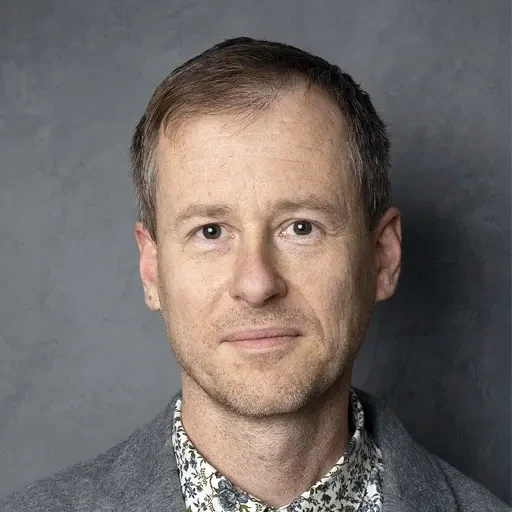
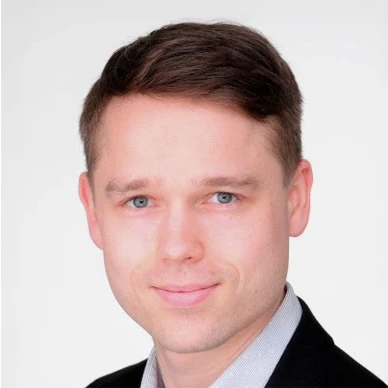
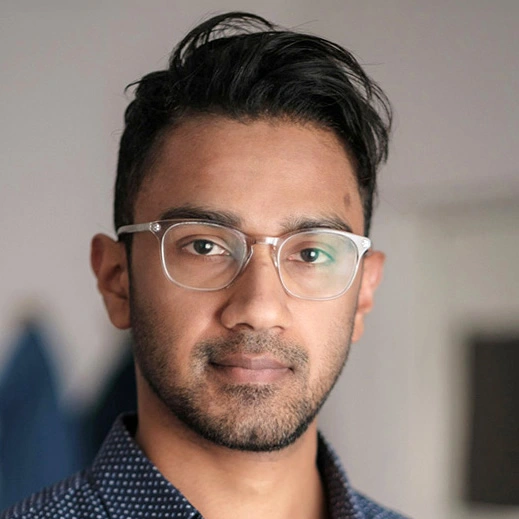
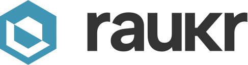
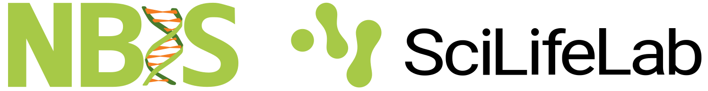

## Organizers

::: {.profile-parent .profile-about}
::: {.profile-child}

::: {.profile-effect}
{.image-effect .nolightbox}

::: {.profile-overlay}
:::
:::

[Marcin Kierczak](http://www.kierczak.pl/)  
Bioinformatics Data Scientist, NBIS,  
Associate Professor in Bioinformatics, Uppsala University

:::
::: {.profile-child}

::: {.profile-effect}
{.image-effect .nolightbox}

::: {.profile-overlay}
:::
:::

[Sebastian DiLorenzo](https://www.katalog.uu.se/profile?id=N11-2322)  
Bioinformatics Data Scientist, NBIS, Uppsala University

:::
::: {.profile-child}

::: {.profile-effect}
{.image-effect .nolightbox}

::: {.profile-overlay}
:::
:::

[Roy Francis](https://www.katalog.uu.se/empinfo/?id=N14-525)  
Bioinformatics Data Scientist, NBIS, Uppsala University

:::
:::

## Contact

[NBIS](https://nbis.se) is a platform of the Science for Life Laboratory ([SciLifeLab](https://www.scilifelab.se/)) and the Swedish node of [ELIXIR](https://elixir-europe.org/). This event is organized by NBIS in collaboration with Uppsala University Campus Gotland.

For questions, contact us at **raukr[at]nbis.se**.

---

<a href="https://nbisweden.github.io/raukr-2027">RaukR • Data Science With R</a>, a workshop created by <a href="https://nbis.se/">NBIS</a> is licensed under <a href="https://creativecommons.org/licenses/by-nc-sa/4.0/">CC BY-NC-SA 4.0</a>

{height="1.2em" style="margin-bottom:-3px;"} &nbsp; {height="1.1em"} &nbsp; [](https://www.instagram.com/raukr_nbis/) &nbsp; [](https://bsky.app/profile/nbis.se) &nbsp; [](https://www.linkedin.com/company/nbisweden) &nbsp; [](https://github.com/NBISweden/raukr-2027)  
