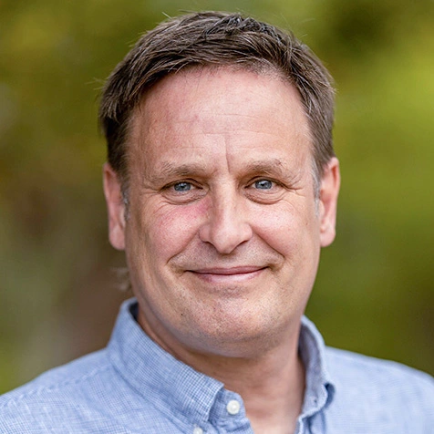

## Guest instructors

::: {.profile-parent .profile-guest}
::: {.profile-child}

::: {.profile-effect}
{.nolightbox}

::: {.profile-overlay}
:::
:::

[**Hadley Wickham**](https://hadley.nz/)  

Chief Scientist at [Posit](https://posit.co/)  
Houston, United States  

:::

::: {.profile-child}

::: {.profile-effect}
{.nolightbox}

::: {.profile-overlay}
:::
:::

[**Jenny Bryan**](https://jennybryan.org/)  

Software engineer at [Posit](https://posit.co/)  
Vancouver, Canada  

:::

::: {.profile-child}

::: {.profile-effect}
{.nolightbox}

::: {.profile-overlay}
:::
:::

[**Henrik Bengtsson**](https://www.linkedin.com/in/henrikbengtsson/)  

Project lead for [Futureverse](https://www.futureverse.org/)  
Associate professor in Epidemiology & Biostatistics  
[University of California](https://profiles.ucsf.edu/henrik.bengtsson)  
San Francisco, USA  

:::
:::

## Syllabus

The workshop covers R programming practices and tools for efficient, reproducible data analysis. Topics typically include:

- Coding in Positron IDE
- R coding style and best practices
- Code debugging, optimization, and profiling
- Parallel computing in R with Futurverse
- Creating reports, presentations, and websites with Quarto
- R and AI, from code completions to agents
- Object-oriented programming and R class systems, including S3, S4, and R6
- The anatomy of an R package and how to create one from scratch
- Tidy data analysis with the tidyverse
- Data visualization in R
- Developing web applications using Shiny
- Collaborative work using Git and GitHub
- A team project applying the workshop skills to an R data analysis workflow

::: {.callout-note}
The exact topics may change based on participant feedback, instructor availability, and emerging trends in R programming.
:::

## Course materials

Course materials will be published at the beginning of the workshop and will remain publicly accessible online for at least one year. You can browse the [RaukR 2026 materials](https://nbisweden.github.io/raukr-2026/home_contents.html) in the meantime.

## Sessions

Our daily schedule begins with a morning session from 09:00 to 12:30. There will be a 30-minute break at 10:30. Lunch is scheduled for 12:30 to 13:30, followed by the afternoon session from 13:30 to 17:00, which includes another 30-minute break at 15:00.

Online guest lectures may take place after 17:00 because of time-zone differences. A detailed schedule will be published before the workshop.

During most sessions, our instructors and teaching assistants will be available to support you with practical exercises and to answer any questions you may have.
