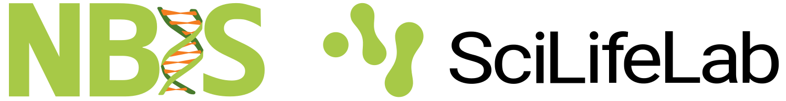

::: {.home-container}
::: {.home-inner}

## [RaukR • Data Science With R]{.large}
### Summer School 2027
##### 16-26 August 2027, Visby, Gotland, Sweden

The R programming language is a powerful tool for data transformation, statistical analysis, and creating publication-ready visualizations. This workshop goes beyond the basics, giving participants a comprehensive understanding of the R ecosystem. We cover best coding practices, code profiling, data wrangling, generating reports from notebooks, and developing web applications using R.

::: {.hidden}
::: {.home-buttons}

[ Apply now!](home_registration.html){.btn .btn-primary}

:::
:::

{height="1.2em" style="margin-bottom:-3px;"} &nbsp; {height="1.1em"}

---

::: small
Updated:  at .
:::

:::
:::



<!-- typeform signup form -->

