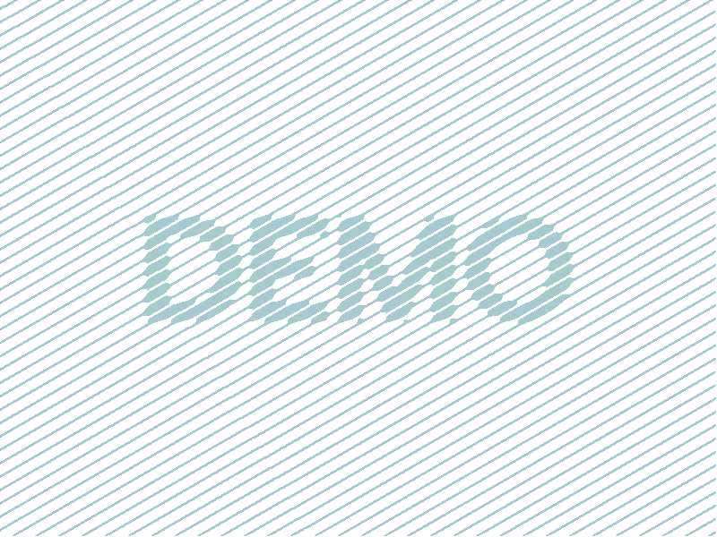

```{r}
#| echo: false

# data handling
library(dplyr)
library(tidyr)
library(stringr)

# tables
library(knitr)
library(htmlTable) # enhanced HTML tables
library(kableExtra) # complete table
library(formattable) # table with conditional formatting
library(gt) # enhanced tables
library(DT) # interactive table
library(reactable) # interactive table

# graphics
library(ggplot2) # static graphics

# interactive graphics
library(highcharter)
library(plotly)
library(ggiraph) # convert ggplot to interactive
library(dygraphs) # time series
library(networkD3) # network graph
library(leaflet) # interactive maps
library(crosstalk) # linking plots

# extras
library(fontawesome) # icons

# custom ggplot theme
theme_report <- function(basesize = 12) {
  theme_bw(base_size = basesize) %+replace%
    theme(
      panel.border = element_blank(),
      panel.grid.minor = element_blank(),
      panel.grid.major.x = element_blank(),
      legend.position = "top",
      legend.direction = "horizontal"
    )
}
```

This is a [Quarto](https://quarto.org/) document.

## Text formatting

### Headings

```
## Level 2 heading
### Level 3 heading
#### Level 4 heading
##### Level 5 heading
###### Level 6 heading
```

### Character sizes

Custom text sizes are provided by this template.

|Markdown|Rendered|
|---|---|
|`[Largest text]{.largest}`|[Largest text]{.largest}|
|`[Larger text]{.larger}`|[Larger text]{.larger}|
|`[Large text]{.large}`|[Large text]{.large}|
|Normal text |Normal text|
|`[Small text]{.small}`|[Small text]{.small}|
|`[Smaller text]{.smaller}`|[Smaller text]{.smaller}|
|`[Smallest text]{.smallest}`|[Smallest text]{.smallest}|

### Character styles

|Markdown|Rendered|
|---|---|
|`__Bold text__`|__Bold text__|
|`_Italic text_`|_Italic text_|
|`~~Strikethrough~~`|~~Strikethrough~~|
|`H~2~O`|H~2~O|
|`x^2^`|x^2^|
|`--`|--|
|`---`|---|
|`[link](https://example.com/)`|[link](https://example.com/)|
|`{}`||

### Blockquote

```
> This is a block quote. This
> paragraph has two lines.
>
> 1. This is a list inside a block quote.
> 2. Second item.
```

> This is a block quote. This paragraph has two lines.
>
> 1.  This is a list inside a block quote.
> 2.  Second item.

### Line block

A line block preserves spaces and line breaks.

```
| This
|     block
|          preserves
|                   formatting
```

| This
|     block
|          preserves
|                   formatting

### Rule

A horizontal line can be created using three or more `*` or `-`.

`***`

------------------------------------------------------------------------

### Footnote

An example of a footnote reference.[^1]

[^1]: That reference refers to this footnote.

### Aside

`[This content lives in the right margin]{.aside}`

[This content lives in the right margin]{.aside}

### Buttons

Here is how buttons are defined:

`[button]{.btn}`  [button]{.btn}  
`[button]{.btn .btn-primary}`  [button]{.btn .btn-primary}  
`[button]{.btn .btn-secondary}`  [button]{.btn .btn-secondary}  
`[button]{.btn .btn-tertiary}`  [button]{.btn .btn-tertiary}  

Button sizes

`[button]{.btn .btn-xs}`  [button]{.btn .btn-xs}  
`[button]{.btn .btn-sm}`  [button]{.btn .btn-sm}  
`[button]{.btn}`  [button]{.btn}  
`[button]{.btn .btn-lg}`  [button]{.btn .btn-lg}  

Links inside buttons

`[[link](https://example.com/)]{.btn}`  [[link](https://example.com/)]{.btn}  
`[[link](https://example.com/)]{.btn .btn-primary}`  [[link](https://example.com/)]{.btn .btn-primary}  
`[[link](https://example.com/)]{.btn .btn-secondary}`  [[link](https://example.com/)]{.btn .btn-secondary}  
`[[link](https://example.com/)]{.btn .btn-tertiary}`  [[link](https://example.com/)]{.btn .btn-tertiary}  

### Badge

Here is how badges are defined:

`[badge]{.badge}`  [badge]{.badge}  
`[badge]{.badge .badge-primary}`  [badge]{.badge .badge-primary}  
`[badge]{.badge .badge-secondary}`  [badge]{.badge .badge-secondary}  
`[badge]{.badge .badge-tertiary}`  [badge]{.badge .badge-tertiary}  

Links inside badges.

`[[link](https://example.com/)]{.badge .badge-primary}`  [[link](https://example.com/)]{.badge .badge-primary}  
`[[link](https://example.com/)]{.badge .badge-secondary}`  [[link](https://example.com/)]{.badge .badge-secondary}  
`[[link](https://example.com/)]{.badge .badge-tertiary}`  [[link](https://example.com/)]{.badge .badge-tertiary}  

## Code formatting

Verbatim code is text formatted in a monospaced font and intended to be read as code. Inline verbatim code is enclosed in backticks, so `` `date()` `` renders as `date()`.

Verbatim code can also be placed in fenced code blocks.

````
```
date()
```
````

```
date()
```

**Code sizing**

```
[`Sys.Date()`]{.largest}
[`Sys.Date()`]{.larger}
[`Sys.Date()`]{.large}
`Sys.Date()`
[`Sys.Date()`]{.small}
[`Sys.Date()`]{.smaller}
[`Sys.Date()`]{.smallest}
```

[`Sys.Date()`]{.largest}\
[`Sys.Date()`]{.larger}\
[`Sys.Date()`]{.large}\
`Sys.Date()`\
[`Sys.Date()`]{.small}\
[`Sys.Date()`]{.smaller}\
[`Sys.Date()`]{.smallest}


R code can be executed inline: `` `r "\u0060r Sys.Date()\u0060"` `` renders as `r Sys.Date()`.

R code can also be executed in code chunks.

````
```{{r}}
Sys.Date()
```
````

This shows the source code and output.

```{r}
Sys.Date()
```

Here is another example with R source code and output.

```{r}
data(iris)
head(iris[,1:2])
```

## Chunk options

Code chunk behavior is controlled with chunk options. In R chunks, each option starts with `#|` and uses YAML `key: value` syntax, for example, `#| eval: false`.

In this example, the R source code and results are hidden but the code is evaluated.

````         
```{{r}}
#| eval: true
#| echo: false
#| results: hide
Sys.Date()
```
````

Source code blocks can be folded.

````         
```{{r}}
#| code-fold: true
Sys.Date()
```
````

```{r}
#| code-fold: true
Sys.Date()
```

Quarto does not provide built-in output folding, so this template uses the [`quarto-collapse-output`](https://github.com/mcanouil/quarto-collapse-output) extension.

````
```{{r}}
#| output-fold: true
Sys.Date()
```
````

```{r}
#| output-fold: true
Sys.Date()
```

Use `filename` to display a filename above a code chunk.

````
```{{r}}
#| filename: R code
Sys.Date()
```
````

```{r}
#| filename: R code
#| eval: false
Sys.Date()
```

Enable line numbers using `code-line-numbers: true`.

````
```{{r}}
#| code-line-numbers: true
Sys.Date()
sessionInfo()
```
````

```{r}
#| eval: false
#| code-line-numbers: true
Sys.Date()
sessionInfo()
```

An example showing Bash code generated from R:

````
```{{r}}
#| attr-output: "filename='bash'"
#| class-output: bash
#| echo: false
d <- "custom"
cat(paste("mkdir", d))
```
````

```{r}
#| attr-output: "filename='bash'"
#| class-output: bash
#| echo: false
d <- "custom"
cat(paste("mkdir", d))
```

See Quarto's [execution options](https://quarto.org/docs/computations/execution-options.html) and [HTML code options](https://quarto.org/docs/output-formats/html-code.html).

## Lists

### Unordered

Unordered lists are created using dashes.

::: {.grid}
::: {.g-col-6}

```
- Bullet 1
- Bullet 2
  - Sub-bullet 2.1
  - Sub-bullet 2.2
- Bullet 3
```

:::
::: {.g-col-6}

- Bullet 1
- Bullet 2
  - Sub-bullet 2.1
  - Sub-bullet 2.2
- Bullet 3

:::
:::

### Ordered

Ordered lists are created using numbers.

::: {.grid}
::: {.g-col-6}

```
1. Point 1
2. Point 2
3. Point 3
```

:::
::: {.g-col-6}

1. Point 1
2. Point 2
3. Point 3

:::
:::

### Multiple lists

::: {.grid}
::: {.g-col-6}

```
::: {}
1. Point 1
2. Point 2
:::

::: {}
1. Point 1
2. Point 2
:::
```

:::
::: {.g-col-6}

::: {}
1. Point 1
2. Point 2
:::

::: {}
1. Point 1
2. Point 2
:::

:::
:::

## Bootstrap

[Bootstrap](https://getbootstrap.com/docs/5.0/utilities/text/) provides many built-in utility classes. Here are some examples:

`[lOwerCase]{.text-lowercase}`  [lOwerCase]{.text-lowercase}  
`[lOwerCase]{.text-uppercase}`  [lOwerCase]{.text-uppercase}  
`[lOwerCase]{.text-capitalize}`  [lOwerCase]{.text-capitalize}  
`[lOwerCase]{.fs-2}`  [lOwerCase]{.fs-2}  
`[lOwerCase]{.fw-bold}`  [lOwerCase]{.fw-bold}  
`[lOwerCase]{.fw-bolder}`  [lOwerCase]{.fw-bolder}  
`[lOwerCase]{.fw-light}`  [lOwerCase]{.fw-light}  
`[lOwerCase]{.fw-lighter}`  [lOwerCase]{.fw-lighter}  
`[lOwerCase]{.fst-italic}`  [lOwerCase]{.fst-italic}  
`[lOwerCase]{.text-muted}`  [lOwerCase]{.text-muted}  
`[lOwerCase]{.text-decoration-underline}`  [lOwerCase]{.text-decoration-underline}  
`[lOwerCase]{.text-decoration-line-through}`  [lOwerCase]{.text-decoration-line-through}  

## Images

Images can be inserted using Markdown or HTML. In Markdown, Quarto attributes can control image properties. With the project's `lightbox: auto` setting, clicking an image opens it in a lightbox.

### Using Markdown

Using regular Markdown.

```

```


By default, an image uses its actual size, constrained by the available width. You can change its displayed dimensions as shown below.

```
{width=30%}
```

{width="30%"}

This image is now 30% of the available width.

#### Figure layout

```
::: {#fig-mylabel layout-ncol=2}
{width="40%" fig-align="center"}

{width="40%" fig-align="center"}

These figures are interesting.
:::
```

::: {#fig-mylabel layout-ncol="2"}
{width="40%" fig-align="center"}

{width="40%" fig-align="center"}

These figures are interesting.
:::

More figure options and layouts are described [here](https://quarto.org/docs/authoring/figures.html). Cross-referencing is described [here](https://quarto.org/docs/authoring/cross-references.html).

Here are some [Bootstrap](https://getbootstrap.com/docs/5.0/utilities/shadows/) styles:

`{width="20%" class="shadow-sm rounded"}`

{width="20%" class="shadow-sm rounded"}

`{width="20%" class="shadow rounded"}`

{width="20%" class="shadow rounded"}

`{width="20%" class="shadow-lg rounded-pill"}`

{width="20%" class="shadow-lg rounded-pill"}

### Using HTML

The image below is displayed at 30% width.\
``


## Static images using R

Use the `out-width` chunk option to control an image's displayed width.

The image below is displayed at 300 pixels wide.

````
```{{r}}
#| out-width: 300px

```
````

```{r}
#| echo: false
#| out-width: "300px"

```

The image below is displayed at 75 pixels wide and has a caption.

````
```{{r}}
#| out-width: 75px
#| fig-cap: This is a caption

```
````

```{r}
#| echo: false
#| out-width: "75px"
#| fig-cap: This is a caption

```

See Quarto's [figure documentation](https://quarto.org/docs/authoring/figures.html) for more information. R-generated plots are demonstrated below.

## Math expressions

Some examples of rendering equations.

::: {.grid}
::: {.g-col-6}

```
$e^{i\pi} + 1 = 0$
```

:::
::: {.g-col-6}

$e^{i\pi} + 1 = 0$

:::
:::

::: {.grid}
::: {.g-col-6}

```
$$\frac{E \times X^2 \prod I}{2+7} = 432$$
```

:::
::: {.g-col-6}

$$\frac{E \times X^2 \prod I}{2+7} = 432$$

:::
:::

::: {.grid}
::: {.g-col-6}

```
$$\sum_{i=1}^n X_i$$
```

:::
::: {.g-col-6}

$$\sum_{i=1}^n X_i$$

:::
:::

::: {.grid}
::: {.g-col-6}

```
$$\int_0^{2\pi} \sin x~dx$$
```

:::
::: {.g-col-6}

$$\int_0^{2\pi} \sin x~dx$$

:::
:::

::: {.grid}
::: {.g-col-6}

```
$\left( \sum_{i=1}^{n}{i} \right)^2 = \left( \frac{n(n+1)}{2}\right)^2 = \frac{n^2(n+1)^2}{4}$
```

:::
::: {.g-col-6}

$\left( \sum_{i=1}^{n}{i} \right)^2 = \left( \frac{n(n+1)}{2}\right)^2 = \frac{n^2(n+1)^2}{4}$

:::
:::

::: {.grid}
::: {.g-col-6}

```
$$\begin{aligned} X &\sim \mathrm{N}(0,1), \quad Y \sim \chi^2_{n-p}, \quad X \perp Y\\ R &\equiv \frac{X}{\sqrt{Y/(n-p)}} \sim t_{n-p} \end{aligned}$$
```

:::
::: {.g-col-6}

$$\begin{aligned} X &\sim \mathrm{N}(0,1), \quad Y \sim \chi^2_{n-p}, \quad X \perp Y\\ R &\equiv \frac{X}{\sqrt{Y/(n-p)}} \sim t_{n-p} \end{aligned}$$

:::
:::

::: {.grid}
::: {.g-col-6}

```
$$\begin{aligned} \mu &= \mathbb{E}[X], \quad k > 0,\\ P(|X-\mu| > k) &= P(|X-\mu|^2 > k^2)\\ &\leq \frac{\mathbb{E}[|X-\mu|^2]}{k^2}\\ &= \frac{\mathrm{Var}(X)}{k^2} \end{aligned}$$
```

:::
::: {.g-col-6}

$$\begin{aligned} \mu &= \mathbb{E}[X], \quad k > 0,\\ P(|X-\mu| > k) &= P(|X-\mu|^2 > k^2)\\ &\leq \frac{\mathbb{E}[|X-\mu|^2]}{k^2}\\ &= \frac{\mathrm{Var}(X)}{k^2} \end{aligned}$$

:::
:::

## Icons

### Bootstrap Icons

[Bootstrap Icons](https://icons.getbootstrap.com) are available in Quarto HTML documents that use a Bootstrap-based theme. The Quarto [bsicons](https://github.com/shafayetShafee/bsicons) extension provides a shortcode interface.


`<i class="bi bi-lightbulb-fill"></i>`  <i class="bi bi-lightbulb-fill"></i>  
`<i class="bi bi-exclamation-circle-fill"></i>`  <i class="bi bi-exclamation-circle-fill"></i>  
`<i class="bi bi-clipboard2-check-fill"></i>`  <i class="bi bi-clipboard2-check-fill"></i>  
`<i class="bi bi-chat-fill"></i>`  <i class="bi bi-chat-fill"></i>  
`<i class="bi bi-laptop-fill"></i>`  <i class="bi bi-laptop-fill"></i>  
`<i class="bi bi-cloud-fill"></i>`  <i class="bi bi-cloud-fill"></i>  
`<i class="bi bi-github"></i>`  <i class="bi bi-github"></i>  

### Font Awesome

To use [Font Awesome](https://fontawesome.com/search?m=free) icons with shortcodes, install the Quarto [fontawesome extension](https://github.com/quarto-ext/fontawesome).

Icons can be placed using shortcodes.

`{}`        
`{}`      
`{}`   
`{}`         
`{}`          
`{}`            
`{}`            
`{}`            
`{}`            
`{}`    
`{}`    
`{}`    

Icons can be displayed using the HTML `<i>` tag. Note that not all icons may work.

`Here is a <i class="fa fa-calendar"></i> calendar and a <i class="fa fa-couch"></i> couch.`

Here is a <i class="fa fa-calendar"></i> calendar and a <i class="fa fa-couch"></i> couch.

There are many other Quarto extensions for icons, such as [academicons](https://github.com/schochastics/academicons), [iconify](https://github.com/mcanouil/quarto-iconify), and [lordicons](https://github.com/jmgirard/lordicon).

For a full list of icons, see [Font Awesome](https://fontawesome.com/search?m=free).

Icons can be placed programatically through R using the R package `fontawesome`.

`` `r "\u0060r fontawesome::fa('lightbulb')\u0060"` ``

`r fontawesome::fa("lightbulb")`

Optional arguments are height and fill.

`` `r "\u0060r fontawesome::fa('lightbulb',height='30px',fill='steelblue')\u0060"` ``

`r fontawesome::fa("lightbulb",height='30px',fill='steelblue')`

For full list of icons check out [FontAwesome](https://fontawesome.com/search?m=free).


## Callouts

[Callout blocks](https://quarto.org/docs/authoring/callouts.html) draw attention to specific information. Quarto provides five types: note, tip, caution, warning, and important.

```
::: {.callout-note}
Use notes for supplementary context that does not require the reader to take action. This should be the default for most things.
:::

::: {.callout-tip}
Use tips for optional advice that can make a task easier or more efficient.
:::

::: {.callout-caution}
Use cautions when an action could have unwanted consequences that the reader should consider first.
:::

::: {.callout-warning}
Use warnings for actions that could cause mistakes, data loss, or other significant problems.
:::

::: {.callout-important}
Use important callouts for essential information the reader must understand before continuing.
:::
```

::: {.callout-note}
Use notes for supplementary context that does not require the reader to take action. This should be the default for most things.
:::

::: {.callout-tip}
Use tips for optional advice that can make a task easier or more efficient.
:::

::: {.callout-caution}
Use cautions when an action could have unwanted consequences that the reader should consider first.
:::

::: {.callout-warning}
Use warnings for actions that could cause mistakes, data loss, or other significant problems.
:::

::: {.callout-important}
Use important callouts for essential information the reader must understand before continuing.
:::

Callout variations.

```
::: {.callout-tip collapse="true"}
## Collapsible callout

This content is inside a collapsible callout.
:::
```

::: {.callout-tip collapse="true"}
## Collapsible callout

This content is inside a collapsible callout.
:::

Simple appearance

```
::: {.callout-note appearance="simple"}
This is a callout with a simple appearance.
:::
```

::: {.callout-note appearance="simple"}
This is a callout with a simple appearance.
:::

Minimal appearance

```
::: {.callout-note appearance="minimal"}
This is a callout with a minimal appearance.
:::
```

::: {.callout-note appearance="minimal"}
This is a callout with a minimal appearance.
:::

## Alerts

Alerts are Bootstrap components, not Quarto callouts.

```
::: {.alert .alert-primary}
**Note:** This is an alert!
:::
::: {.alert .alert-secondary}
**Note:** This is an alert!
:::
::: {.alert .alert-success}
**Note:** This is a success alert!
:::
::: {.alert .alert-danger}
**Note:** This is a danger alert!
:::
::: {.alert .alert-warning}
**Note:** This is a warning alert!
:::
::: {.alert .alert-info}
**Note:** This is an info alert!
:::
```

::: {.alert .alert-primary}
**Note:** This is an alert!
:::

::: {.alert .alert-secondary}
**Note:** This is an alert!
:::

::: {.alert .alert-success}
**Note:** This is a success alert!
:::

::: {.alert .alert-danger}
**Note:** This is a danger alert!
:::

::: {.alert .alert-warning}
**Note:** This is a warning alert!
:::

::: {.alert .alert-info}
**Note:** This is an info alert!
:::

## Layout

### Span

`[Content inside span]{style="background-color: gray"}`

[Content inside span]{style="background-color: gray"}

### Div

```
::: {style="background-color: gray"}
Content inside div
:::
```

::: {style="background-color: gray"}
Content inside div
:::

Divs can be nested like this:

```
:::: {.class}
::: {.class}
:::
::::
```

Both spans and divs support attributes in this specific order: identifiers, classes, and then key-value attributes.

`[Content inside span]{#id .class key1="val1" key2="val2"}`

### Hidden div

```
::: {.hidden}
Hidden content
:::
```

### Conditional content

````
::: {.content-visible when-format="html"}
Will only appear in HTML.
:::
````

````
::: {.content-hidden when-format="html"}
Will not appear in HTML.
:::
````

Conditional content is documented [here](https://quarto.org/docs/authoring/conditional.html).

### Inner columns

Organization of content into columns within the body container.

```
:::: {.columns}
::: {.column style="background-color: aliceblue"}
Content in left column.
:::
::: {.column style="background-color:  #f5b7b1"}
Content in right column.
:::
::::
```

::: columns
::: {.column style="background-color: aliceblue"}
Content in left column.
:::

::: {.column style="background-color:  #f5b7b1"}
Content in right column.
:::
:::

<br>

This is an example of nested columns.

```
:::: {.columns}

::: {.column style="background-color: aliceblue"}
Content in left column.
:::

::: {.column}
Content in right column.

:::: {.columns}
::: {.column style="background-color: #d0ece7"}
Nested left.
:::
::: {.column style="background-color: #f2d7d5"}
Nested right.
:::
::::

:::

::::
```

::: columns
::: {.column style="background-color: aliceblue"}
Content in left column.
:::

::: column
Content in right column.

::: columns
::: {.column style="background-color: #d0ece7"}
Nested left.
:::

::: {.column style="background-color: #f2d7d5"}
Nested right.
:::
:::
:::
:::

### Outer columns

Extending content outside the body container.

```
::: {.column-body style="background-color: lightgray; margin-bottom:0.5em;"}
.column-body
:::

::: {.column-body-outset style="background-color: lightgray; margin-bottom:0.5em;"}
.column-body-outset
:::

::: {.column-page-inset style="background-color: lightgray; margin-bottom:0.5em;"}
.column-page-inset
:::

::: {.column-page style="background-color: lightgray; margin-bottom:0.5em;"}
.column-page
:::

::: {.column-screen-inset style="background-color: lightgray; margin-bottom:0.5em;"}
.column-screen-inset
:::

::: {.column-screen style="background-color: lightgray; margin-bottom:0.5em;"}
.column-screen
:::

::: {.column-body-outset-right style="background-color: lightgray; margin-bottom:0.5em;"}
.column-body-outset-right
:::

::: {.column-page-inset-right style="background-color: lightgray; margin-bottom:0.5em;"}
.column-page-inset-right
:::

::: {.column-page-right style="background-color: lightgray; margin-bottom:0.5em;"}
.column-page-right
:::

::: {.column-screen-inset-right style="background-color: lightgray; margin-bottom:0.5em;"}
.column-screen-inset-right
:::

::: {.column-screen-right style="background-color: lightgray; margin-bottom:0.5em;"}
.column-screen-right
:::

::: {.column-body-outset-left style="background-color: lightgray; margin-bottom:0.5em;"}
.column-body-outset-left
:::

::: {.column-page-inset-left style="background-color: lightgray; margin-bottom:0.5em;"}
.column-page-inset-left
:::

::: {.column-page-left style="background-color: lightgray; margin-bottom:0.5em;"}
.column-page-left
:::

::: {.column-screen-inset-left style="background-color: lightgray; margin-bottom:0.5em;"}
.column-screen-inset-left
:::

::: {.column-screen-left style="background-color: lightgray; margin-bottom:0.5em;"}
.column-screen-left
:::

::: {.column-margin style="background-color: lightgray; margin-bottom:0.5em;"}
.column-margin
:::
```

::: {.column-body style="background-color: lightgray; margin-bottom:0.5em;"}
.column-body
:::

::: {.column-body-outset style="background-color: lightgray; margin-bottom:0.5em;"}
.column-body-outset
:::

::: {.column-page-inset style="background-color: lightgray; margin-bottom:0.5em;"}
.column-page-inset
:::

::: {.column-page style="background-color: lightgray; margin-bottom:0.5em;"}
.column-page
:::

::: {.column-screen-inset style="background-color: lightgray; margin-bottom:0.5em;"}
.column-screen-inset
:::

::: {.column-screen style="background-color: lightgray; margin-bottom:0.5em;"}
.column-screen
:::

::: {.column-body-outset-right style="background-color: lightgray; margin-bottom:0.5em;"}
.column-body-outset-right
:::

::: {.column-page-inset-right style="background-color: lightgray; margin-bottom:0.5em;"}
.column-page-inset-right
:::

::: {.column-page-right style="background-color: lightgray; margin-bottom:0.5em;"}
.column-page-right
:::

::: {.column-screen-inset-right style="background-color: lightgray; margin-bottom:0.5em;"}
.column-screen-inset-right
:::

::: {.column-screen-right style="background-color: lightgray; margin-bottom:0.5em;"}
.column-screen-right
:::

::: {.column-body-outset-left style="background-color: lightgray; margin-bottom:0.5em;"}
.column-body-outset-left
:::

::: {.column-page-inset-left style="background-color: lightgray; margin-bottom:0.5em;"}
.column-page-inset-left
:::

::: {.column-page-left style="background-color: lightgray; margin-bottom:0.5em;"}
.column-page-left
:::

::: {.column-screen-inset-left style="background-color: lightgray; margin-bottom:0.5em;"}
.column-screen-inset-left
:::

::: {.column-screen-left style="background-color: lightgray; margin-bottom:0.5em;"}
.column-screen-left
:::

::: {.column-margin style="background-color: lightgray; margin-bottom:0.5em;"}
.column-margin
:::

### Tabset panel

```
::: {.panel-tabset}
#### Sub topic 1

This is some material for topic 1.

#### Sub topic 2

This is some material for topic 2.

:::
```

::: panel-tabset
#### Sub topic 1

This is some material for topic 1.

#### Sub topic 2

This is some material for topic 2.
:::

More layout settings are described [here](https://quarto.org/docs/authoring/article-layout.html) and [here](https://quarto.org/docs/output-formats/page-layout.html).

## Tables

### Manual

For simple cases, tables can be manually created in Markdown.

::: {.grid}
::: {.g-col-7}

```         
|speed|dist|
|-----|----|
|4    |   2|
|4    |  10|
|7    |   4|
```

:::
::: {.g-col-5}

| speed | dist |
|-------|------|
| 4     | 2    |
| 4     | 10   |
| 7     | 4    |

:::
:::

Table caption and numbering can be added as such:

::: {.grid}
::: {.g-col-7}

```         
|speed|dist|
|-----|----|
|4    |   2|
|4    |  10|
|7    |   4|

: These are exciting results. {#tbl-mylabel}
```

:::
::: {.g-col-5}

| speed | dist |
|-------|------|
| 4     | 2    |
| 4     | 10   |
| 7     | 4    |

: These are exciting results. {#tbl-mylabel}

:::
:::

More information about [tables](https://quarto.org/docs/authoring/tables.html).

### Margin table

A table placed in the margin.

```
::: {.column-margin}

| speed | dist |
|-------|------|
| 4     | 2    |
| 4     | 10   |
| 7     | 4    |

:::
```

::: {.column-margin}

| speed | dist |
|-------|------|
| 4     | 2    |
| 4     | 10   |
| 7     | 4    |

:::

### kable

A simple table using `knitr::kable()`.

```{r}
library(knitr)
kable(head(iris))
```

#### Layout

````
```{{r}}
#| column: body-outset
#| label: tbl-dual-table
#| tbl-cap: "Example"
#| tbl-subcap: 
#|   - "Cars"
#|   - "Pressure"
#| layout-ncol: 2

kable(head(cars))
kable(head(pressure))
```
````

```{r}
#| echo: false
#| column: body-outset
#| label: tbl-dual-table
#| tbl-cap: "Example"
#| tbl-subcap:
#|   - "Cars"
#|   - "Pressure"
#| layout-ncol: 2

kable(head(cars))
kable(head(pressure))
```

#### Cross-referencing

Figures and tables can be numbered and cross-referenced by assigning a label that starts with `fig-` or `tbl-`, respectively. For example, `@tbl-dual-table` references the table above and renders as @tbl-dual-table.

#### Margin table

````
```{{r}}
#| tbl-cap: This table is in the margin.
#| column: margin

head(cars)
```
````

```{r}
#| tbl-cap: This table is in the margin.
#| column: margin
#| echo: false

head(cars)
```

### paged

An interactive table using `rmarkdown::paged_table()`.

```{r}
library(rmarkdown)
rmarkdown::paged_table(head(iris))
```

### gt

The [gt](https://gt.rstudio.com/) package provides a grammar of tables with extensive customization options.

```{r}
library(gt)

iris |>
    group_by(Species) |>
    slice(1:4) |>
    gt() |>
    cols_label(
      Sepal.Length = "Sepal Length", Sepal.Width = "Sepal Width",
      Petal.Length = "Petal Length", Petal.Width = "Petal Width"
    ) |>
    tab_source_note(
        source_note = md("Source: Iris data (Anderson, 1936; Fisher, 1936)")
    )
```

### htmlTable

The [htmlTable](https://github.com/gforge/htmlTable) package creates styled HTML tables from R objects.

```{r}
library(htmlTable)

iris1 <- iris[c(1:4,51:53,105:108),]
htmlTable(iris1, rgroup=unique(iris1$Species), n.rgroup=rle(as.character(iris1$Species))$lengths)
```

### kableExtra

The [`kableExtra`](https://cran.r-project.org/web/packages/kableExtra/vignettes/awesome_table_in_html.html) and [`formattable`](https://cran.r-project.org/web/packages/formattable/vignettes/formattable-data-frame.html) packages provide advanced table styling.

```{r}
#| tbl-cap: Table using kableextra.
library(kableExtra)

iris[c(1:4,51:53,105:108),] |>
  mutate(Sepal.Length=color_bar("lightsteelblue")(Sepal.Length)) |>
  mutate(Sepal.Width=color_tile("white","orange")(Sepal.Width)) |>
  mutate(Species=cell_spec(Species,"html",color="white",bold=T,
    background=c("#8dd3c7","#fb8072","#bebada")[factor(Species)])) |>
  kable("html",escape=F) |>
  kable_styling(bootstrap_options=c("striped","hover","responsive"),
                full_width=F,position="left") |>
  column_spec(5,width="3cm")
```

### DT

The [`DT`](https://rstudio.github.io/DT/) package creates interactive data tables.

```{r}
#| tbl-cap: Interactive table using DT.
library(DT)

iris |>
  slice(1:15) |>
  datatable(options = list(pageLength = 7))
```

### reactable

The [reactable](https://glin.github.io/reactable/index.html) package creates advanced interactive tables.

```{r}
library(reactable)

reactable(iris[sample(1:150,10),],
  columns = list(
    Sepal.Length = colDef(name = "Sepal Length"),
    Sepal.Width = colDef(name = "Sepal Width"),
    Petal.Length = colDef(name = "Petal Length"),
    Petal.Width = colDef(name = "Petal Width")
  ),
  striped = TRUE,
  highlight = TRUE,
  filterable = TRUE
)
```

The [reactablefmtr](https://github.com/kcuilla/reactablefmtr/) package can simplify and extend reactable tables.

## Static plots

### Base plot

-   Plots using base R are widely used and may be good enough for most situations.
-   But they lack a consistent coding framework.

```{r}
#| fig-height: 6
#| fig-width: 6
#| label: fig-plot-base
#| fig-cap: Static plot using base plot.

{
  plot(x=iris$Sepal.Length,y=iris$Sepal.Width,
      col=c("coral","steelblue","forestgreen")[iris$Species],
      xlab="Sepal Length",ylab="Sepal Width",pch=19)

  legend(x=7,y=4.47,legend=c("setosa","versicolor","virginica"),
        col=c("coral","steelblue","forestgreen"),pch=19)
}
```

#### Multiple plots

````
```{{r}}
#| column: screen-inset-shaded
#| layout-nrow: 1
#| fig-cap:
#|   - "Scatterplot of speed vs distance"
#|   - "Pairwise scatterplot of all variables"
#|   - "Scatterplot of temperature vs pressure"

plot(cars)
plot(iris)
plot(pressure)
```
````

```{r}
#| column: screen-inset-shaded
#| layout-nrow: 1
#| echo: false
#| fig-cap:
#|   - "Scatterplot of speed vs distance"
#|   - "Pairwise scatterplot of all variables"
#|   - "Scatterplot of temperature vs pressure"

plot(cars)
plot(iris)
plot(pressure)
```

#### Margin plot

````
```{{r}}
#| column: margin

plot(cars)
```
````

```{r}
#| column: margin
#| echo: false

plot(cars)
```

### ggplot2

The [`ggplot2`](https://ggplot2.tidyverse.org/) package provides a grammar of graphics for creating static plots.

```{r}
#| fig-height: 6
#| fig-width: 8
#| label: fig-ggplot
#| fig-cap: Static plot using ggplot2.
#| column: margin
library(ggplot2)

iris |>
  ggplot(aes(x=Sepal.Length,y=Sepal.Width,col=Species))+
  geom_point(size=2)+
  labs(x="Sepal Length",y="Sepal Width")+
  theme_report()
```

## Interactive plots

### highcharter

The [`highcharter`](https://jkunst.com/highcharter/) package provides an R interface to the [Highcharts](https://www.highcharts.com/) JavaScript library.

```{r}
#| label: fig-highcharter
#| fig-cap: Interactive scatterplot using highcharter.
library(highcharter)

h <- hchart(iris,"scatter",hcaes(x="Sepal.Length",y="Sepal.Width",group="Species")) |>
  hc_xAxis(title=list(text="Sepal Length"),crosshair=TRUE) |>
  hc_yAxis(title=list(text="Sepal Width"),crosshair=TRUE) |>
  hc_chart(zoomType="xy",inverted=FALSE) |>
  hc_legend(verticalAlign="top",align="right") |>
  hc_size(height=400)

htmltools::tagList(list(h))
```

### plotly

The [`plotly`](https://plotly.com/r/) package provides an R interface to the [Plotly.js](https://plotly.com/) JavaScript library.

```{r}
#| label: fig-plotly
#| fig-cap: Interactive scatterplot using plotly.
library(plotly)

p <- iris |>
  plot_ly(x=~Sepal.Length,y=~Sepal.Width,color=~Species,width=500,height=400) |>
  add_markers()
p
```

### ggplotly

`plotly::ggplotly()` converts a ggplot2 plot into an interactive Plotly graphic.

```{r}
#| fig-height: 5
#| fig-width: 7
#| label: fig-ggplotly
#| fig-cap: Interactive scatterplot using ggplotly.
library(plotly)

p <- iris |>
  ggplot(aes(x=Sepal.Length,y=Sepal.Width,col=Species))+
  geom_point()+
  labs(x="Sepal Length",y="Sepal Width")+
  theme_bw(base_size=12)

ggplotly(p,width=500,height=400)
```

### ggiraph

The `ggiraph` package adds tooltips, hover effects, and other interactions to ggplot2 graphics.

```{r}
#| fig-height: 5
#| fig-width: 7
#| label: fig-ggiraph
#| fig-cap: Interactive scatterplot using ggiraph.
library(ggiraph)

p <- ggplot(iris,aes(x=Sepal.Length,y=Petal.Length,colour=Species))+
      geom_point_interactive(aes(tooltip=paste0("<b>Petal Length:</b> ",Petal.Length,"\n<b>Sepal Length: </b>",Sepal.Length,"\n<b>Species: </b>",Species)),size=2)+
  theme_bw()

tooltip_css <- "background-color:#e7eef3;font-family:Roboto;padding:10px;border-style:solid;border-width:2px;border-color:#125687;border-radius:5px;"

girafe(code=print(p),
  options=list(
    opts_hover(css="cursor:pointer;stroke:black;fill-opacity:0.3"),
    opts_zoom(max=5),
    opts_tooltip(css=tooltip_css,opacity=0.9)
  )
)
```

### dygraphs

The [`dygraphs`](https://rstudio.github.io/dygraphs/) package provides R bindings to the [dygraphs](https://dygraphs.com/) JavaScript library for interactive time-series charts.

```{r}
#| fig-height: 5
#| fig-width: 9
#| label: fig-dygraphs
#| fig-cap: Interactive time series plot using dygraph.
library(dygraphs)

lungDeaths <- cbind(ldeaths, mdeaths, fdeaths)
dygraph(lungDeaths,main="Deaths from Lung Disease (UK)") |>
  dyOptions(colors=c("#66C2A5","#FC8D62","#8DA0CB"))
```

### Network graph

The `networkD3` package creates interactive network graphs using [D3.js](https://d3js.org/).

```{r}
#| label: fig-networkd3
#| fig-cap: Interactive network plot.
library(networkD3)

data(MisLinks,MisNodes)
forceNetwork(Links=MisLinks,Nodes=MisNodes,Source="source",
             Target="target",Value="value",NodeID="name",
             Group="group",opacity=0.4)
```

### leaflet

The [`leaflet`](https://rstudio.github.io/leaflet/) package provides R bindings to the [Leaflet](https://leafletjs.com/) JavaScript library.

```{r}
#| label: fig-leaflet
#| fig-cap: Interactive map using leaflet.
library(leaflet)

leaflet(height=500,width=700) |>
  addTiles(urlTemplate='https://{s}.tile.openstreetmap.org/{z}/{x}/{y}.png') |>
  #addProviderTiles(providers$Esri.NatGeoWorldMap) |>
  addMarkers(lat=57.639327,lng=18.288534,popup="RaukR") |>
  setView(lat=57.639327,lng=18.288534,zoom=15)
```

### crosstalk

The [`crosstalk`](https://rstudio.github.io/crosstalk/index.html) package links selections and filters across compatible HTML widgets that share a `SharedData` object.

```{r}
#| fig-height: 8
#| label: fig-crosstalk
#| fig-cap: Linking independent plots using crosstalk.
library(crosstalk)

shared_quakes <- SharedData$new(quakes[sample(nrow(quakes), 100),])
lf <- leaflet(shared_quakes,height=300) |>
        addTiles(urlTemplate='https://{s}.tile.openstreetmap.org/{z}/{x}/{y}.png') |>
        addMarkers()
py <- plot_ly(shared_quakes,x=~depth,y=~mag,size=~stations,height=300) |>
        add_markers()

htmltools::div(lf,py)
```

## Observable JS

Quarto supports [Observable JS](https://observablehq.com/) for interactive visualizations in the browser.

Pass data from R to OJS:

```{r}
irism <- iris
colnames(irism) <- gsub("[.]","_",tolower(colnames(irism)))
ojs_define(ojsd = irism)
```

```{ojs}
ojsdata = transpose(ojsd)
```

Display the data as a table:

```{ojs}
viewof filtered_table = Inputs.table(ojsdata)
```

Define inputs:

```{ojs}
viewof x = Inputs.select(Object.keys(ojsdata[0]), {value: "sepal_length", multiple: false, label: "X axis"})
```

```{ojs}
viewof y = Inputs.select(Object.keys(ojsdata[0]), {value: "sepal_width", multiple: false, label: "Y axis"})
```

Display the plot:

```{ojs}
Plot.plot({
  marks: [
    Plot.dot(ojsdata, {
      x: x,
      y: y,
      fill: "species",
      title: (d) =>
        `${d.species} \n Petal length: ${d.petal_length} \n Sepal length: ${d.sepal_length}`
    })
  ],
  grid: true
})
```

See Quarto's [Observable JS documentation](https://quarto.org/docs/interactive/ojs/).

## General tips

-   Use level-2 headings (`##`) as the highest heading level:

  ```markdown
  ## Section A
  ```

-   Add a custom stylesheet in the YAML front matter if needed:

    ```yaml
    format:
      html:
        css: my-theme.css
    ```
-   See the [Quarto documentation](https://quarto.org/)

## Session

<details>
  <summary>Click here</summary>

```{r}
#| label: session

sessionInfo()
```

</details>

