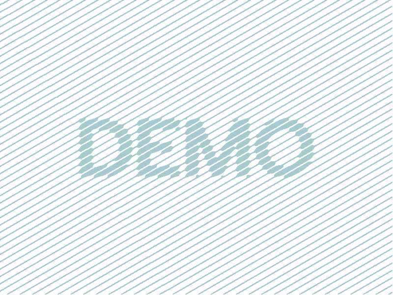

## Packages {visibility="hidden"}

```{r}
#| echo: false

library(dplyr)
library(tidyr)
library(stringr)
library(kableExtra)
library(formattable)
library(DT)
library(reactable)
library(ggplot2)
library(htmltools)
library(highcharter)
library(plotly)
library(ggiraph)
library(networkD3)
library(leaflet)
library(crosstalk)
```

## Introduction

::: {.large}
This is a [Quarto](https://quarto.org/) [Reveal.js](https://revealjs.com) presentation. This demo showcases general authoring and presentation capabilities. Reveal.js in Quarto is documented [here](https://quarto.org/docs/presentations/revealjs/).
:::

Press  to enable the pointer and press  again to hide it.

## Getting started

Add YAML front matter to the top of a `.qmd` file.

```yaml
---
title: "This is a title"
format: revealjs
---
```

Render it from a terminal:

```sh
quarto render slide.qmd
```

## Slides

#### Slide separators

Slides are separated by `##`. They can be with or without a title. Slides can be hidden or not counted in slide numbering.

```markdown
##
## Normal title
## Slide Title {visibility="hidden"}
## Slide Title {visibility="uncounted"}
```

#### Slide notes

Content inside `.notes` is visible only in presenter mode. Press  to enable presenter mode.

#### Keyboard shortcuts

- Press  for help.

::: {.notes}
Here are some slide notes. Press  again to exit presenter mode.
:::

## Incremental content

Incremental content is separated by `. . .` (three dots with spaces) like seen now

. . . 

More control is possible with the `.incremental` class and `.fragment` class.

:::{.columns}
:::{.column width="50%" .fragment}

```markdown
::: {.incremental}
- Incremental item 1
- Incremental item 2
:::
```

::: {.incremental}
- Incremental item 1
- Incremental item 2
:::

:::
:::{.column width="50%" .fragment}

```markdown
::: {.fragment}
Content A
:::
::: {.fragment}
Content B
:::
```

::: {.fragment}
Content A
:::
::: {.fragment}
Content B
:::

:::
:::

## Layout content

The slide content can be organized into nested columns.

```markdown
:::{.columns}
:::{.column width="50%"}

::: {style="background-color:#fdebd0"}
Left content
:::

:::
:::{.column width="50%"}

::: {style="background-color:#eaf2f8"}
Right content
:::

:::
:::
```

:::{.columns}
:::{.column width="50%"}

::: {style="background-color:#fdebd0"}
Left content
:::

:::
:::{.column width="50%"}

::: {style="background-color:#eaf2f8"}
Right content
:::

:::
:::

## Text vertical alignment

::: {.columns}
::: {.column width="33%"}

::: {.v-top}
```markdown
::: {.v-top}
Top-aligned content
:::
```
:::

:::
::: {.column width="33%"}

::: {.v-center}
```markdown
::: {.v-center}
Centered content
:::
```
:::

:::
::: {.column width="33%"}

::: {.v-bottom}
```markdown
::: {.v-bottom}
Bottom-aligned content
:::
```
:::

:::
:::

## Text horizontal alignment

`[Left aligned text]{.left}`  
[Left aligned text]{.left}

`[Center aligned text]{.center}`  
[Center aligned text]{.center}

`[Right aligned text]{.right}`  
[Right aligned text]{.right}

## Text alignment vertical horizontal center

```markdown
::: {.v-center .center}
Centered content
:::
```

::: {.v-center .center}
Centered content
:::

## Panel tabs

::: {.panel-tabset}

### Tab A

Content for `Tab A`.

### Tab B

Content for `Tab B`.

:::

## Text formatting

::: {.columns}
::: {.column width="60%"}

ABCDEFGHIJKLMNOPQRSTUYWXYZÅÄÖ

abcdefghijklmnopqrstuvwxyzåäö

0123456789

!"#%&/()$@*^~<>-:;,_±|?+=

`This is **bold**` produces **bold** text

`This is *italic*` produces *italic* text

`~~Strikethrough~~` produces ~~strikethrough~~ text

This is subscript `H~2~O` H~2~O and superscript `2^10^` 2^10^

```markdown
> This line is quoted.
```

> This line is quoted.

:::
::: {.column width="40%" .fragment}

```markdown
[Largest text]{.largest}
[Larger text]{.larger}
[Large text]{.large}
Normal text
[Small text]{.small}
[Smaller text]{.smaller}
[Smallest text]{.smallest}
```

[Largest text]{.largest}\
[Larger text]{.larger}\
[Large text]{.large}\
Normal text\
[Small text]{.small}\
[Smaller text]{.smaller}\
[Smallest text]{.smallest}

`This is a [link](https://example.com/)` This is a [link](https://example.com/)

:::
:::

## Buttons and badges

`[[button](http://example.com)]{.btn}`  [[button](http://example.com)]{.btn}

`[[button](http://example.com)]{.btn .btn-primary}`  [[button](http://example.com)]{.btn .btn-primary}

`[[button](http://example.com)]{.btn .btn-secondary}`  [[button](http://example.com)]{.btn .btn-secondary}

`[[button](http://example.com)]{.btn .btn-tertiary}`  [[button](http://example.com)]{.btn .btn-tertiary}


`This is a [badge]{.badge .badge-primary}`  
This is a [badge]{.badge .badge-primary}

`This is a secondary [badge]{.badge .badge-secondary}`  
This is a secondary [badge]{.badge .badge-secondary}

`This is a tertiary [badge]{.badge .badge-tertiary}`  
This is a tertiary [badge]{.badge .badge-tertiary}

## Fit and aside text

```markdown
::: {.r-fit-text}
Attention
:::
```

::: {.r-fit-text}
Attention
:::

::: {.aside}
In a Reveal.js presentation, `.aside` content is pushed to the bottom.
:::

## Lists

:::: {.columns}
::: {.column width="50%"}

```markdown
- Bullet 1
- Bullet 2
  - Sub-bullet 2.1
```

- Bullet 1
- Bullet 2
  - Sub-bullet 2.1

```markdown
:::{.incremental}
- Bullet 1
- Bullet 2
  - Sub-bullet 2.1
:::
```

:::{.incremental}
- Bullet 1
- Bullet 2
  - Sub-bullet 2.1
:::

:::
::: {.column width="50%" .fragment}

```markdown
1. Item 1
2. Item 2
3. Item 3
```

1. Item 1
2. Item 2
3. Item 3

```markdown
:::{.incremental}
1. Incremental item 1
2. Incremental item 2
3. Incremental item 3
:::
```

::: {.incremental}
1. Incremental item 1
2. Incremental item 2
3. Incremental item 3
:::

:::
::::

## Custom CSS styling

- You can style text using any custom CSS
- This is block styling.

```markdown
::: {style="color: red"}
This paragraph is red.
:::
```

::: {style="color: red"}
This paragraph is red.
:::

- This is inline styling.

`[This text is blue]{style="color: blue"}`

[This text is blue]{style="color: blue"}

## Callouts


:::: {.columns}
::: {.column width="40%"}

```         
::: {.callout-note}
This is a callout.
:::

::: {.callout-tip}
This is a callout.
:::

::: {.callout-caution}
This is a callout.
:::

::: {.callout-warning}
This is a callout.
:::

::: {.callout-important}
This is a callout.
:::
```

:::

::: {.column width="60%"}
::: callout-note
This is a callout.
:::

::: callout-tip
This is a callout.
:::

::: callout-caution
This is a callout.
:::

::: callout-warning
This is a callout.
:::

::: callout-important
This is a callout.
:::

:::
::::

::: {.aside}
CallOut blocks are documented [here](https://quarto.org/docs/authoring/callouts.html)
:::

## Callouts

Variants of callout

:::: {.columns}
::: {.column width="50%"}

```         
::: {.callout-note icon=false}
Icon is disabled
:::

::: {.callout-note appearance="simple"}
Appearance is simple
:::

::: {.callout-note appearance="minimal"}
Appearance is minimal
:::

::: {.callout-note appearance="simple"}
## Custom title
Simple appearance and a custom title
:::

::: {.callout-note appearance="minimal"}
## Custom title
Minimal appearance and a custom title
:::
```

:::

::: {.column width="50%"}

::: {.callout-note icon=false}
Icon is disabled
:::

::: {.callout-note appearance="simple"}
Appearance is simple
:::

::: {.callout-note appearance="minimal"}
Appearance is minimal
:::

::: {.callout-note appearance="simple"}
## Custom title
Simple appearance and a custom title
:::

::: {.callout-note appearance="minimal"}
## Custom title
Minimal appearance and a custom title
:::

:::
::::

## Accordions

Accordion support is provided through the [accordion](https://github.com/royfrancis/quarto-accordion) extension.

Accordion contents can be defined in the YAML header as shown below.

```yaml
accordion:
  - ac-1:
    - header: "**This is a header**"
      body: "This is **bold** and *italic* text"
```

and then called in the body using the shortcode.

```lua
{}
```



## Inline Accordions

An accordion can also be defined inline as shown below.

```lua
{}
```



Multiple inline items are defined using JSON.

```
{{{< accordion label="inline-multi" items='[
  { "header": "Inline Item 1", "body": "Content for inline item 1." },
  { "header": "Inline Item 2", "body": "Content for inline item 2." }
]' >}}}
```

{{< accordion label="inline-multi" items='[
  { "header": "Inline Item 1", "body": "Content for inline item 1." },
  { "header": "Inline Item 2", "body": "Content for inline item 2." }
]' >}}

## Code formatting

## Code

Inline R code is evaluated within text content. This text `` `r "\u0060r Sys.Date()\u0060"` `` produces this: `r Sys.Date()`.

R code is executed inside R code chunks.

````
```{{r}}
Sys.Date()
```
````

Code chunks display their code and output by default.

```{r}
Sys.Date()
```

## Hide code or output

Chunk options can control the display of source and results.

::: {.columns}
::: {.column width="50%"}

Hide source code:

````
```{{r}}
#| echo: false
data(iris)
```
````

```{r}
#| echo: false
data(iris)
head(iris[1:3, 1:2])
```

:::
::: {.column width="50%"}

Hide output:

````
```{{r}}
#| results: "hide"
Sys.Date()
```
````

```{r}
#| results: "hide"
Sys.Date()
```

:::
:::

::: {.aside}
Execution options are documented [here](https://quarto.org/docs/computations/execution-options.html){.small}
:::

## Code folding

::: {.columns}
::: {.column width="50%"}

Source code can be folded while keeping output visible.

````
```{{r}}
#| code-fold: true
Sys.Date()
```
````

```{r}
#| code-fold: true
Sys.Date()
```

:::
::: {.column width="50%"}

The `mcanouil/collapse-output` extension can be used to fold output.

```{r}
#| output-fold: true
Sys.Date()
```

:::
:::

## Code sizing

:::: {.columns}
::: {.column}

**Source code**

```{r}
#| class-source: small
Sys.Date()
```

```{r}
#| class-source: smaller
Sys.Date()
```

:::
::: {.column}

**Source and output**

```{r}
#| classes: small
Sys.Date()
```

```{r}
#| classes: smallest
Sys.Date()
```

:::
::::

## Code highlighting

````
```{{r}}
#| code-line-numbers: "2-3"
iris |>
  head() |>
  knitr::kable()
```
````

```{r}
#| code-line-numbers: "2-3"

iris |>
  head() |>
  knitr::kable()
```

[For more code highlighting documentation, see [here](https://quarto.org/docs/presentations/revealjs/#code-blocks).]{.smaller}

## Images • Markdown

:::: {.columns}
::: {.column width="50%"}

```markdown

```


:::
::: {.column width="50%"}

```markdown
{width=50%}
{width=20%}
```

{width=50%}
{width=20%}

:::
::::

## Images • Markdown layout

```markdown
::: {layout-ncol=3}
{#fig-layout-1 fig-align="center"}

{#fig-layout-2 fig-align="center"}

{#fig-layout-3 fig-align="center"}
:::
```

::: {layout-ncol=3}
{#fig-layout-1 fig-align="center"}

{#fig-layout-2 fig-align="center"}

{#fig-layout-3 fig-align="center"}
:::

## Images • Absolute positioning

```markdown
{.absolute top=250 left=0 height="450"}
{.absolute top=200 right=50 height="250"}
{.absolute bottom=0 right=200 height="200"}
```

{.absolute top=250 left=0 height="450"}
{.absolute top=200 right=50 height="250"}
{.absolute bottom=0 right=200 height="200"}

## Images • HTML

**Using Raw HTML**

This image is 30% size.

``


## Images • R

R chunks can use `out-width` to control image dimensions.

````
```{{r}}
#| echo: false
#| out-width: "100px"

```
````

```{r}
#| echo: false
#| out-width: "100px"

```

## Stacking

:::: {.columns}
::: {.column width="50%"}

Stack images and display incrementally

```markdown
::: {.r-stack}
::: {.fragment}

:::
::: {.fragment}

:::
:::
```

:::
::: {.column width="50%"}

::: {.r-stack}
::: {.fragment}
{style="transform:rotate(-5deg);border:beige 40px solid;"}
:::
::: {.fragment}
{style="transform:rotate(5deg);border:beige 40px solid;"}
:::
:::

:::
::::

## Stretching

Stretch images to use up remaining space

```markdown
{.stretch}
```

{.stretch}

## Math expressions

Some examples of rendering equations

:::: {.columns}
::: {.column width="60%"}

```text
$e^{i\pi} + 1 = 0$

$$\frac{E \times X^2 \prod I}{2+7} = 432$$

$$\sum_{i=1}^n X_i$$
```

:::
::: {.column width="40%"}

$e^{i\pi} + 1 = 0$
$$\frac{E \times X^2 \prod I}{2+7} = 432$$
$$\sum_{i=1}^n X_i$$
$$\int_0^{2\pi} \sin x~dx$$

:::
::::

## Math expressions

Some examples of rendering equations

:::: {.columns}
::: {.column width="60%"}

```
$\left( \sum_{i=1}^{n}{i} \right)^2 = \left( \frac{n(n+1)}{2}\right)^2 = \frac{n^2(n+1)^2}{4}$

$\begin{eqnarray} X & \sim & \mathrm{N}(0,1)\\ Y & \sim & \chi^2_{n-p}\\ R & \equiv & X/Y \sim t_{n-p} \end{eqnarray}$

$\begin{eqnarray} P(|X-\mu| > k) & = & P(|X-\mu|^2 > k^2)\\ & \leq & \frac{\mathbb{E}\left[|X-\mu|^2\right]}{k^2}\\ & \leq & \frac{\mathrm{Var}[X]}{k^2} \end{eqnarray}$
```

:::

::: {.column width="40%"}

$\left( \sum_{i=1}^{n}{i} \right)^2 = \left( \frac{n(n+1)}{2}\right)^2 = \frac{n^2(n+1)^2}{4}$

$\begin{eqnarray} X & \sim & \mathrm{N}(0,1)\\ Y & \sim & \chi^2_{n-p}\\ R & \equiv & X/Y \sim t_{n-p} \end{eqnarray}$

$\begin{eqnarray} P(|X-\mu| > k) & = & P(|X-\mu|^2 > k^2)\\ & \leq & \frac{\mathbb{E}\left[|X-\mu|^2\right]}{k^2}\\ & \leq & \frac{\mathrm{Var}[X]}{k^2} \end{eqnarray}$

:::
::::

## Table

Simple markdown table

```markdown
|Item|Category|Cost|
|---|:---:|---:|
|Apple|Food|$10|
|Bus|Transport|$15|
```

|Item|Category|Cost|
|---|:---:|---:|
|Apple|Food|$10|
|Bus|Transport|$15|

## Tables • kable

The most simple table using kable from R package knitr.

```{r}
knitr::kable(head(iris), "html")
```

## Tables • gt

Tables using the [gt](https://gt.rstudio.com/) package. Grammar of tables with extensive customization options.

:::: {.columns}
::: {.column width="60%"}

```{r}
#| eval: false
library(gt)
iris |>
  group_by(Species) |>
  slice(1:2) |>
  gt() |>
  cols_label(Sepal.Length = "Sepal Length", Sepal.Width = "Sepal Width")
```

:::
::: {.column width="40%"}

```{r}
#| echo: false
library(gt)
iris |>
  group_by(Species) |>
  slice(1:2) |>
  gt() |>
  cols_label(Sepal.Length = "Sepal Length", Sepal.Width = "Sepal Width")
```

:::
::::

## Tables • kableExtra

More advanced table using [`kableExtra`](https://cran.r-project.org/web/packages/kableExtra/vignettes/awesome_table_in_html.html) and [`formattable`](https://cran.r-project.org/web/packages/formattable/vignettes/formattable-data-frame.html).

```{r}
 iris[c(1:2,51:52,105:106),] |>
  mutate(Sepal.Length=color_bar("lightsteelblue")(Sepal.Length)) |>
  mutate(Sepal.Width=color_tile("white","orange")(Sepal.Width)) |>
  mutate(Species=cell_spec(Species,"html",color="white",bold=T,
    background=c("#8dd3c7","#fb8072","#bebada")[factor(Species)])) |>
  kable("html",escape=F) |>
  kable_styling(bootstrap_options=c("striped","hover","responsive"),full_width=F) |>
  column_spec(5,width="3cm")
```

## Interactive tables • DT

Interactive table using R package [`DT`](https://rstudio.github.io/DT/).

```{r}
library(DT)
DT::datatable(iris[1:20, ], options = list(pageLength = 7))
```

## Interactive tables • reactable

Interactive tables with [reactable](https://glin.github.io/reactable/index.html).

```{r}
library(reactable)
reactable(iris[sample(1:150, 6), ], striped = TRUE, highlight = TRUE, filterable = TRUE)
```

## Static plots • base R

```{r}
#| fig-height: 6
#| fig-width: 6

par(mar = c(5, 5, 0, 0))
plot(
  x = iris$Sepal.Length, y = iris$Sepal.Width,
  col = c("coral", "steelblue", "forestgreen")[iris$Species],
  xlab = "Sepal Length", ylab = "Sepal Width", pch = 19
)
legend("bottomright", legend = levels(iris$Species), col = c("coral", "steelblue", "forestgreen"), pch = 19)
```

## Static plots • ggplot2

Plotting using [`ggplot2`](http://ggplot2.org/).

```{r}
#| fig-height: 6
#| fig-width: 8

iris |>
  ggplot(aes(x = Sepal.Length, y = Sepal.Width, colour = Species)) +
  geom_point(size = 2) +
  labs(x = "Sepal Length", y = "Sepal Width") +
  theme_bw(base_size = 18)
```

## Interactive time series • `dygraphs`

R package [`dygraphs`](http://rstudio.github.io/dygraphs/) provides R bindings for javascript library [dygraphs](http://dygraphs.com/) for time series data.

```{r}
#| fig-height: 4
#| fig-width: 9
library(dygraphs)
lungDeaths <- cbind(ldeaths, mdeaths, fdeaths)
dygraph(lungDeaths,main="Deaths from Lung Disease (UK)") |>
  dyOptions(colors=c("#66C2A5","#FC8D62","#8DA0CB"))
```

## Interactive plots • highcharter

R package [`highcharter`](http://jkunst.com/highcharter/) is a wrapper around javascript library [`highcharts`](https://www.highcharts.com/).

```{r}
library(highcharter)
h <- iris |>
  hchart("scatter", hcaes(x = "Sepal.Length", y = "Sepal.Width", group = "Species")) |>
  hc_xAxis(title = list(text = "Sepal Length"), crosshair = TRUE) |>
  hc_yAxis(title = list(text = "Sepal Width"), crosshair = TRUE) |>
  hc_chart(zoomType = "xy") |>
  hc_size(height = 300, width = 500)
htmltools::tagList(h)
```

## Interactive plots • plotly

R package [`plotly`](https://plot.ly/r/) provides R binding around javascript plotting library [`plotly`](https://plot.ly).

```{r}
library(plotly)
iris |>
  plot_ly(x = ~Sepal.Length, y = ~Sepal.Width, color = ~Species, width = 550, height = 400) |>
  add_markers()
```

## Interactive plots • plotly • ggplotly

plotly has a function called `ggplotly` which converts a static ggplot2 object into an interactive plot.

```{r}
library(plotly)
p <- ggplot(iris, aes(x = Sepal.Length, y = Sepal.Width, colour = Species)) +
  geom_point() +
  theme_bw(base_size = 12)

plotly::ggplotly(p, width = 460, height = 360)
```

## Interactive plots • ggiraph

R package [`ggiraph`](https://github.com/davidgohel/ggiraph) converts a static ggplot2 object into an interactive plot.

```{r}
#| fig-height: 2
#| fig-width: 6
library(ggiraph)
p <- ggplot(iris,aes(x=Sepal.Length,y=Petal.Length,colour=Species))+
      geom_point_interactive(aes(tooltip=paste0("<b>Petal Length:</b> ",Petal.Length,"\n<b>Sepal Length: </b>",Sepal.Length,"\n<b>Species: </b>",Species)),size=1)+
  theme_bw()
tooltip_css <- "background-color:#f8f9f9;padding:10px;border-style:solid;border-width:2px;border-color:#125687;border-radius:5px;"
girafe(code=print(p), height_svg=1.5, width_svg=3.5,
  options=list(opts_hover(css="cursor:pointer;stroke:black;fill-opacity:0.3"), opts_zoom(max=5),
    opts_tooltip(css=tooltip_css,opacity=0.9), opts_sizing(width=0.6)))
```

## Network graph • networkD3

R package `networkD3` allows the use of interactive network graphs from the [D3.js](https://d3js.org/) javascript library.

```{r}
library(networkD3)
data(MisLinks,MisNodes)
forceNetwork(Links=MisLinks,Nodes=MisNodes,Source="source",
             Target="target",Value="value",NodeID="name",
             Group="group",opacity=0.4,
             height=300,width=500)
```

## Interactive maps • Leaflet

R package [`leaflet`](https://rstudio.github.io/leaflet/) provides R bindings for javascript mapping library; [leafletjs](http://leafletjs.com/).

```{r}
library(leaflet)
leaflet(height = 300, width = 800) |>
  addTiles(
    urlTemplate = 'https://{s}.tile.openstreetmap.org/{z}/{x}/{y}.png'
  ) |>
  #addProviderTiles(providers$Esri.NatGeoWorldMap) |>
  addMarkers(lat = 57.639327, lng = 18.288534, popup = "RaukR") |>
  setView(lat = 57.639327, lng = 18.288534, zoom = 15)
```

## Linking plots • crosstalk

R package [`crosstalk`](https://rstudio.github.io/crosstalk/index.html) allows crosstalk enabled plotting libraries to be linked. Through the shared 'key' variable, data points can be manipulated simultaneously on two independent plots.

```{r}
library(crosstalk)
shared_quakes <- SharedData$new(quakes[sample(nrow(quakes), 100),])
lf <- leaflet(shared_quakes,height=300) |>
        addTiles(urlTemplate='http://{s}.tile.openstreetmap.org/{z}/{x}/{y}.png') |>
        addMarkers()
py <- plot_ly(shared_quakes,x=~depth,y=~mag,size=~stations,height=300) |> add_markers()
div(div(lf,style="float:left;width:49%"),div(py,style="float:right;width:49%"))
```

## ObservableJS

- Quarto supports [ObservableJS](https://observablehq.com/) for interactive visualisations in the browser.

:::: {.columns}
::: {.column width="50%"}

Pass data from R to OJS

```{r}
irism <- iris
colnames(irism) <- gsub("[.]","_",tolower(colnames(irism)))
ojs_define(ojsd = irism)
```

```{ojs}
ojsdata = transpose(ojsd)
```

:::
::: {.column width="50%"}

Display as a table

```{ojs}
viewof filtered_table = Inputs.table(ojsdata)
```

:::
::::

## ObservableJS

:::: {.columns}
::: {.column width="60%"}

Define inputs

```{ojs}
viewof x = Inputs.select(Object.keys(ojsdata[0]), {
  value: "sepal_length", multiple: false, label: "X axis"
  })
```

```{ojs}
viewof y = Inputs.select(Object.keys(ojsdata[0]), {
  value: "sepal_width", multiple: false, label: "Y axis"
  })
```

:::
::: {.column width="40%"}

Display plot

```{ojs}
Plot.plot({
  marks: [
    Plot.dot(ojsdata, {
      x: x, y: y, fill: "species",
      title: (d) => `${d.species} \n Petal length: ${d.petal_length} \n Sepal length: ${d.sepal_length}`
    })
  ], grid: true
})
```

:::
::::

ObservableJS in quarto [documentation](https://quarto.org/docs/interactive/index.html#observable-js).

## Interactive maps - Leaflet

The [leaflet](https://github.com/royfrancis/quarto-leaflet) extension uses document metadata and a shortcode to create maps.

```lua
{}
```



## Diagrams

```{mermaid}
%%| echo: fenced
flowchart LR
  A[Hard edge] --> B(Round edge)
  B --> C{Decision}
  C --> D[Result one]
  C --> E[Result two]
```

## Colorful {background-color="#ABEBC6"}

`## Colorful {background-color="#ABEBC6"}`

This slide has a colorful background.

## Big image {background-image="assets/featured.png"}

`## Big image {background-image="assets/featured.png"}`

This slide has a background image.

## Cover slide

Change title slide background image by adjusting the following YAML parameters.

```
---
title-slide-attributes:
  data-background-image: "assets/featured.png"
  data-background-size: "cover"
  data-background-opacity: "1"
---
```

## General tips

- Use `##` as the top level heading for each slide
- Add custom CSS with a `css: "styles.css"` YAML option
- Export HTML to PDF using [DeckTape](https://github.com/astefanutti/decktape)
- Read the complete [Quarto Reveal.js documentation](https://quarto.org/docs/presentations/revealjs/)

## Session

```{r}
#| echo: false
sessionInfo()
```

##  {background-image="/assets/images/network.svg"}

::: {.v-center .center}

[Thank you!]{.largest}

[Questions?]{.larger}

[ • [SciLifeLab](https://www.scilifelab.se/) • [NBIS](https://nbis.se/) • [RaukR](https://nbisweden.github.io/raukr-2027)]{.smaller}

:::

